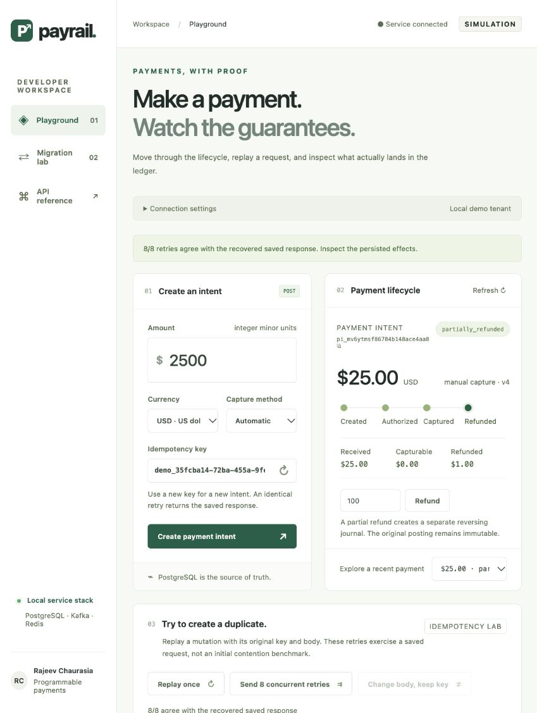
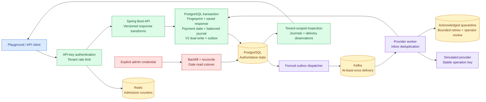

# PayRail

[](https://github.com/rajeev-chaurasia/pay-rail/actions/workflows/ci.yml)

PayRail is a runnable Java 17 / Spring Boot 4.1.1 payment-intent service. PostgreSQL is authoritative for payment state, idempotency, the immutable double-entry ledger, migration state, and the transactional outbox. Kafka carries ordered aggregate events and provider commands. Redis enforces an atomic per-tenant request limit.

This is a simulated rail: it accepts integer minor-unit amounts and never handles card data or moves real money.

Contributor setup, required checks and review conventions are in
[CONTRIBUTING.md](CONTRIBUTING.md). [AGENTS.md](AGENTS.md) is the canonical
contributor contract. [Evidence](docs/evidence.md) explains the concurrency
experiment and independent result validation; [known limits](docs/known-misses.md)
separate local behavior from remaining qualification work.

Delivery is complete for the simulated reference platform. See the
[project closeout](docs/project-closeout.md) for verified scope, cleanup and
future qualification boundaries.

## Measured results

The isolated GCP campaign ran on a **32-vCPU / 120-GiB database/application host**
with four application replicas and a separate **8-vCPU / 32-GiB load generator**.
Payments and historical data were synthetic; the provider was simulated.

| Check | Recorded result | Scope / status |
| --- | --- | --- |
| Historical migration | **100,000,000 objects**, zero missing, extra or mismatched rows | Full copy/reconciliation passed for homogeneous histories |
| HTTP fault campaign | **1,000,000 successful observed actions**, no duplicate ledger effects | Duplicate captures, fingerprint conflicts and discarded committed responses |
| Create-only load | **2,000/s for 60 seconds**, 120,000 accepted; p95 **7.27 ms**, p99 **30.06 ms** | Short client budget passed; sustained settlement capacity is unproven |
| Infrastructure recovery | **5 schedules / 20 observed interruptions** | One balanced settlement and exact response replay per payment |
| 25,000/s target | Bounded probes dropped offered work | **Failed**; 30-minute target qualification was not run |
| Migration foreground traffic | 179,996 accepted out of 180,000 arrivals over 30 minutes; four dropped arrivals | **Failed** the strict zero-drop gate; zero downtime is unproven |

The million-action result does not mean one million crashes or provider timeouts.
Post-overload delivery recovery required index/statistics intervention. Production
readiness, automatic recovery SLOs and a full-scale mid-chunk crash/resume remain
open gates. **All temporary cloud resources were deleted after evidence export.**

[Campaign report and limitations](docs/gcp-qualification-results.md) ·
[Raw observations and checksums](evidence/gcp/q-20261014092401-2304be/) ·
[Million-action raw downloads](https://github.com/rajeev-chaurasia/pay-rail/releases/tag/benchmark-20261014) ·
[Flow coverage](docs/testing.md) ·
[Production gates](docs/production-readiness.md)

## Run locally

Prerequisites are Docker 28+ and Compose v2. The pinned verification image
provides Java 17, Maven, Node and Python; host installs are optional.

```bash
./scripts/dev-up.sh
curl http://localhost:18080/actuator/health
```

Open the [live playground](http://localhost:18080/) to create payments, replay
requests, compare API contracts, and inspect persisted ledger and delivery
events. It ships in the same application; no frontend server is required.
See [the playground walkthrough](docs/playground.md) for a short demonstration.



The local fixture API key is `pr_test_demo`. It is hashed with the local-only default pepper in Flyway. Production startup requires non-default minimum-length secrets, verified transports and a restricted database role; it disables startup DDL and public management/docs endpoints. Follow [the production configuration gates](docs/production-readiness.md) before enabling `prod`.

```bash
curl -X POST http://localhost:18080/v1/payment_intents \
  -H 'Authorization: Bearer pr_test_demo' \
  -H 'Idempotency-Key: order-42-create' \
  -H 'PayRail-Version: 2026-01-01' \
  -H 'Content-Type: application/json' \
  -d '{"amount":1250,"currency":"usd","captureMethod":"manual"}'
```

API docs are at `http://localhost:18080/swagger-ui.html` and the OpenAPI document at `/v3/api-docs`. Compose defaults to the collision-resistant host ports 18080 (HTTP), 15432 (PostgreSQL), 16379 (Redis), and 19092 (Kafka); the `PAYRAIL_*_PORT` variables override them. Stop only this isolated Compose project with `./scripts/dev-down.sh`; its project name is `payrail` and it does not touch unrelated containers.

## API and correctness model



Blue shows clients, green the request and transaction path, amber durable
infrastructure and admission state, violet delivery/provider work, and red
administrative migration controls. The API and workers run from the same
codebase; arrows describe responsibility, not separate deployed microservices.

The API supports create, get, keyset list, confirm, capture, cancel, and refund under `/v1/payment_intents`. Every mutation requires `Idempotency-Key`. The database serializes a key, compares a recursively canonicalized SHA-256 request fingerprint (including API version), performs the state change, ledger posting, V2 dual write, and outbox append, then saves the exact transformed response bytes/status/version in one transaction. A post-commit lost response replays those bytes; a different request or version returns 409.

Supported immutable wire versions are `2025-01-01` (`state`) and `2026-01-01` (`status`). GET and list responses use the requested transform. Payment transitions are explicit: automatic confirmation enters `processing`; the provider worker completes it to `succeeded`. Manual confirmation enters `authorized`, followed by full capture. Cancel, partial/full refund, and terminal-state rules return 409 on illegal edges.

The simulated provider persists a stable `tenant:intent` operation before responding. An injected response loss therefore reconciles on retry without a second provider operation or ledger effect. Kafka listener failures use bounded retries and acknowledged dead-letter publication. If quarantine publication fails, recovery remains unresolved. A quarantined intent needs operator reconciliation before replay; production still requires alerting, access controls and a reviewed retention policy.

Ledger effects have a unique tenant business key. Deferred PostgreSQL constraint triggers require at least two balanced entries and `posted=true` at commit. Posted transactions and entries are immutable; refunds create reversing journals. Composite tenant foreign keys prevent cross-tenant refund, ledger, and V2 references. Tenant read isolation itself is enforced by authenticated predicates in this version; PostgreSQL RLS is not enabled.

The outbox claims bounded batches of independent aggregate heads with `FOR UPDATE SKIP LOCKED`, a 30-second fenced lease, a Kafka send timeout below that lease, and the intent ID as message key. A stale worker cannot acknowledge or fail a newer lease. Kafka preserves order for the normal single-key publish path, while an acknowledgement ambiguity can still produce a late duplicate predecessor; consumers must deduplicate IDs and enforce aggregate versions. Kafka delivery is at least once; `processed_events` supplies consumer-side unique event IDs in the same transaction as provider completion.

## Online V2 migration

Flyway V2 adds an additive representation. Compatibility writes update both tables atomically. `POST /v1/admin/migrations/payment-v2/backfill?batchSize=500` performs a resumable ID-keyset batch whose checkpoint commits with its writes. `/reconcile` compares missing, extra, version, money, status, metadata, and timestamps. `/gate-cutover` records readiness only when full reconciliation is clean. Deterministic tenant/intent cohorts use `MIGRATION_SHADOW_READ_PERCENT` and `MIGRATION_V2_READ_PERCENT`; V2 reads remain gated until reconciliation authorizes cutover. Keep dual writes enabled through the rollback window.

## Verification and qualification

The Docker verifier passes **55 automated cases: 34 Java, one currency and
20 Python validator cases**. It checks real PostgreSQL/Redis behavior, pinned
formatting, package creation, retained evidence, Compose variants and both Go
generators. GitHub CI also builds/scans the runtime and performs isolated crash,
logical restore and physical backup/WAL point-in-time recovery drills.

The real-HTTP lifecycle smoke exercises 34 requests. See the
[flow coverage matrix](docs/testing.md),
[cloud qualification report](docs/gcp-qualification-results.md),
[recovery evidence](docs/postgres-recovery.md) and
[local performance method](docs/performance.md).

<details>
<summary>Local Docker benchmark history, including failed attempts</summary>

<!-- performance-results:start -->
Measured on the shared local Docker host. Latency is per completed HTTP request; failed and dropped work is reported separately.

| Study | Observed work | p95 / p99 | Budget result |
| --- | --- | --- | --- |
| [sustained-a (df169a)](evidence/performance/20261013T182002-sustained-a-df169a/report.json) | 5,906 acknowledged creates | 329.2 / 817.7 ms | Not qualified |
| [sustained-b (c45d42)](evidence/performance/20261013T182202-sustained-b-c45d42/report.json) | 5,990 acknowledged creates | 49.1 / 229.5 ms | Not qualified |
| [mixed (ecffaa)](evidence/performance/20261013T182307-mixed-ecffaa/report.json) | 521 workflows / 4,691 HTTP requests | 195.3 / 3193.0 ms | Not qualified |
| [stress (095c4b)](evidence/performance/20261013T182409-stress-095c4b/report.json) | 16,524 acknowledged creates | 422.3 / 1796.5 ms | Not qualified |
| [baseline-a (f156de)](evidence/performance/20261013T233212-baseline-a-f156de/report.json) | 1,500 acknowledged creates | 29.9 / 112.6 ms | Pass |
| [baseline-b (718ca9)](evidence/performance/20261013T233315-baseline-b-718ca9/report.json) | 1,501 acknowledged creates | 24.7 / 161.1 ms | Pass |
| [mixed-baseline (92d38f)](evidence/performance/20261013T233417-mixed-baseline-92d38f/report.json) | 120 workflows / 120 HTTP requests | 17.6 / 29.9 ms | Not qualified |
| [mixed-baseline (d6a221)](evidence/performance/20261013T233952-mixed-baseline-d6a221/report.json) | 121 workflows / 1,086 HTTP requests | 21.5 / 56.4 ms | Pass |
| [sustained-a (dfdc39)](evidence/performance/20261014T002212-sustained-a-dfdc39/report.json) | 6,001 acknowledged creates | 59.3 / 265.7 ms | Pass |
| [sustained-a (6897da)](evidence/performance/20261014T004051-sustained-a-6897da/report.json) | 6,001 acknowledged creates | 4.9 / 11.7 ms | Pass |
| [sustained-b (e6b816)](evidence/performance/20261014T004153-sustained-b-e6b816/report.json) | 6,000 acknowledged creates | 5.3 / 17.0 ms | Pass |
| [mixed (019998)](evidence/performance/20261014T004256-mixed-019998/report.json) | 601 workflows / 5,594 HTTP requests | 5.4 / 12.0 ms | Pass |
| [stress (92642c)](evidence/performance/20261014T004358-stress-92642c/report.json) | 28,899 acknowledged creates | 6.6 / 37.6 ms | Pass |
| [target-probe (43db10)](evidence/performance/20261014T004622-target-probe-43db10/report.json) | 5,129 acknowledged creates | 327.9 / 405.4 ms | Not qualified |
| [sustained-a (3f3837)](evidence/performance/20261014T010424-sustained-a-3f3837/report.json) | 6,001 acknowledged creates | 4.7 / 15.7 ms | Pass |
| [sustained-b (799e5b)](evidence/performance/20261014T010526-sustained-b-799e5b/report.json) | 6,000 acknowledged creates | 4.5 / 10.3 ms | Pass |
| [mixed (0defb7)](evidence/performance/20261014T010629-mixed-0defb7/report.json) | 600 workflows / 5,623 HTTP requests | 4.9 / 8.3 ms | Pass |
| [stress (e59edc)](evidence/performance/20261014T010731-stress-e59edc/report.json) | 28,899 acknowledged creates | 3.3 / 14.0 ms | Pass |
| [target-probe (b30d31)](evidence/performance/20261014T013320-target-probe-b30d31/report.json) | 1,947 acknowledged creates | 800.7 / 901.4 ms | Not qualified |

Passing create baselines: 25 arrivals/s for 60 seconds and 25 arrivals/s for 60 seconds. The corrected
2 workflow arrivals/s mixed run completed 121 workflows, 1,086 HTTP requests,
174 balanced journals and 116 refunds. Failed higher-rate studies remain retained.
The stress snapshot recorded 0 pending events at its bounded drain deadline.
None of these studies establishes the 25K/s target. See
[the method, failed runs and limits](docs/performance.md).
<!-- performance-results:end -->

</details>

`mvn verify` runs real PostgreSQL 16 Testcontainers tests for duplicate races, fingerprint conflicts, canonical JSON, state conflicts, tenant isolation, ledger balance/immutability, provider response loss and redelivery, pinned wire replay, migration resume/reconcile, and stale outbox fencing.

```bash
mvn verify
./scripts/seed.sh --objects 1000 --seed 42
./scripts/benchmark.sh --profile quick --rate 10 --duration 30s
./scripts/fault-campaign.sh --seed 42 --faults 20
./scripts/reconcile.sh
```

The fault script counts attempted client deadlines and stable-key duplicate retries; a short deadline does not by itself prove that the server committed. The performance harness uses the official pinned k6 Docker image, a dedicated synthetic tenant/app/Redis instance and the existing local PostgreSQL/Kafka stack. It retains raw samples, summaries, resource observations, bounded drain records and consistent accounting snapshots under `evidence/performance/`. Failed capacity runs remain published and classified as unqualified. These local studies retain their original resource/workload limits. The separate [GCP campaign](docs/gcp-qualification-results.md) measured 100M homogeneous historical objects and one million actions across three HTTP fault classes. Sustained 25K/s, zero-downtime migration and broad production fault qualification remain open. Claims require declared workloads and hardware, retained raw observations, full reconciliation and the stated acceptance gates. See [the implementation plan](docs/implementation-plan.md) for the complete fault matrix.

Known limits of this reference service: the fixed-window Redis limiter is intentionally simple; the outbox publishes bounded batches of independent aggregate heads; API keys are managed through SQL rather than a management API; and no external payment provider is integrated.

## Docker verification and production safeguards

```sh
docker compose -p payrail --profile test build verify
docker compose -p payrail --profile test run --rm verify
```

The verification image includes Java, Maven, Node and Python, with disposable
PostgreSQL/Redis tests and Docker-backed load tooling. See
[production safeguards and qualification gates](docs/production-readiness.md)
for separate migration/runtime identities, TLS/secret guards, bounded workers,
Prometheus backlog observations and the remaining release gates.

Disposable Docker [recovery drills](docs/postgres-recovery.md) verify process
crashes, logical restoration and online physical backup/WAL recovery to a named
point. Restored payment delivery stays fenced until reconciliation. Production
backup durability, retention, failover and recovery budgets remain separate gates.
